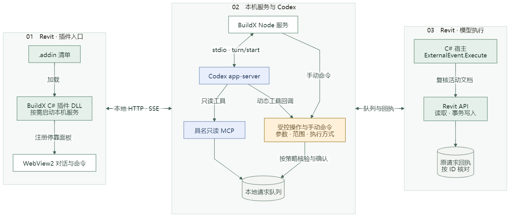

# BuildX 代码与运行位置

核查日期为 2026 年 11 月 7 日。开发入口是 `D:\code\BuildX`。Revit 中打开的试用界面从独立程序目录加载资源，源码修改需经过试用版切换后才能在那里看到。

| 位置 | 用途与状态 |
| --- | --- |
| `D:\code\BuildX` | 独立 Git 仓库，远端为私有 `Walkman1W/buildx-revit`。主工作树在 `codex/native-foundation`，核查时 HEAD 为 `f69c980`，与本地记录的同名远端引用一致。工作区已有大量未提交改动，本轮在原工作区按界面区域修改。 |
| `main` 与 AEC 候选 | 本地 `main` 为规划基线 `95b93e6`，距开发 HEAD 13 个提交。本地远端跟踪引用 `origin/codex/aec-workspace-20261107` 为 `9b9b9c2`，是开发 HEAD 的后代，多 85 个提交。该分支的本地工作树停在 `e980eaf`，较跟踪引用落后 81 个提交。各提交号来自本地 Git 引用。 |
| `artifacts/*/source` 等 | 共 66 个候选工作树，复用同一 Git 库。其中 43 个处于 detached HEAD。共有 25 个不同的工作树提交未被本地 `origin/*` 跟踪引用覆盖，逐项核对交付和提交后再收拢。 |
| `D:\code\REA\local-codex-panel` | 历史版本，位于独立的 REA Git 根之下。检查时 41873 未监听，旧目录及历史回执保留。 |
| `artifacts/callback-reconciled-deploy-20261107/program-v2` | 当前 41874 的 Node 进程从这里启动，Revit 2024 的 BuildX 插件清单也指向其中的 DLL。 |
| `artifacts/local-trial-20261105-02/data` | 现用 schema 2 安装配置指向的数据根。 |
| `artifacts/callback-triage-20261107/candidate` | Revit 2024 的独立回调诊断清单引用这里的 DLL。 |

## 源码分工

| 目录和入口 | 负责内容 |
| --- | --- |
| `server.mjs`、`lib/panel-server.mjs`、`lib/panel-server-core.mjs` | 服务入口、工作区装配、HTTP/SSE、会话和权限路由。 |
| `public/index.html`、`app.js`、`model-workspace.mjs`、`model-picker.mjs` | 共享页面、对话与选择状态、Revit 命令和输入区、模型及思考强度。 |
| `lib/codex-client*.mjs`、`lib/codex-profile.mjs` | Codex app-server 连接、会话能力与模型工具注册。 |
| `lib/model-command-catalog.mjs`、`lib/model-tool-dispatch.mjs`、`lib/model-permission-owner.mjs` | 命令契约、执行分派、模型权限与逐次确认。 |
| `workbench-mcp.mjs`、`lib/workbench-client.mjs`、`revit-addin/WorkbenchHost.cs` | MCP 入口、文件队列与原回执、Revit 回调和执行。具体 Revit 能力位于 `revit-addin/` 和 `family-core/`。 |
| `tools/`、`test-support/`、`docs/migration/` | 构建和安装工具、受控验证夹具、迁移进度与验收证据。 |

## 对话与 Revit API 调用架构

图中包含完整产品工作区的执行路径。跨电脑测试版启用四项具名只读查询。[测试范围与安装](CROSS-PC-READONLY-20261107.zh-CN.md)

1. Revit 启动时通过 `.addin` 装载 BuildX C# 插件。插件注册 Ribbon 和可停靠窗格，打开窗格时核对本机 Node 服务身份，按需启动，再让 WebView2 加载面板。[插件启动](../../revit-addin/LocalCodexRevit.cs#L47) · [服务探测与启动](../../revit-addin/LocalCodexRevit.cs#L896)
2. 对话通过本地 HTTP 交给 Node，Node 通过 stdio JSON-RPC 调用用户本机的 Codex app-server。Codex 根据问题决定调用哪个已注册工具。具名只读工具通过本机 MCP；受控操作通过动态工具回调回到 BuildX。手动命令由面板直接提交，跳过 Codex 推理。[Codex 工具配置](../../lib/codex-profile.mjs#L102) · [动态操作](../../lib/panel-server-core.mjs#L628) · [手动命令](../../lib/panel-server-core.mjs#L2100)
3. BuildX 校验操作参数、文档和访问范围。受控操作按执行方式和命令规则处理，部分操作需要用户逐次确认。请求经本地文件队列进入 C# 宿主，Revit 在 `ExternalEvent.Execute` 回调中再次核对请求并调用 API。写操作在相应事务中执行，保存模型是单独的动作。[权限与分派](../../lib/model-permission-owner.mjs#L186) · [队列传输](../../lib/workbench-client.mjs#L620) · [Revit 回调](../../revit-addin/WorkbenchHost.cs#L588)
4. 宿主以原请求 ID 写出回执。工具结果可交回 Codex 继续生成答案，面板通过 SSE 更新对话和执行状态。等待超时保留未知状态，后续查原回执。[宿主回执](../../revit-addin/WorkbenchHost.cs#L740) · [SSE](../../lib/panel-server-core.mjs#L1538) · [回执超时](../../lib/workbench-client.mjs#L726)

例如，问「查看当前选中的构件」时，Codex 可以调用 `revit_get_selection`。C# 宿主读取 `Selection.GetElementIds()`，结果返回给 Codex 用于整理回答。面板直接勾选「当前选择」时，BuildX 可通过上下文接口读取同类信息。[读取选择](../../revit-addin/WorkbenchActions.cs#L33)

图按当前源码绘制。本机核对了 41874 的 Node 进程仍来自独立试用目录，本轮仅做源码核对与图示渲染。可下载 [SVG](../../diagrams/buildx-revit-architecture.svg)、[Mermaid 源文件](../../diagrams/buildx-revit-architecture.mmd) 或 [Excalidraw](../../diagrams/buildx-revit-architecture.excalidraw)。

## 本轮归档

在 `artifacts/archive/workspace-tidy-20261107` 保留三项原名目录。

- `buildx-revit2024-internal-20261105-01` 和 `buildx-revit2024-internal-20261105-02` 是两份旧安装展开物，各 122 个文件。历史验收记录所引用的 `-03` 保留在原位。
- `closure-package-plugin-20261107` 是未使用的空候选目录。
- 本机 `artifacts/archive/workspace-tidy-20261107/manifest.json` 记录原路径、归档路径及 244 个文件的字节数和 SHA-256。移动前后的逐文件核对一致。恢复时，确认清单记录的原路径仍为空，再按原目录名移回。

## 界面范围

- 勾选「当前选择」后即时读取一次，行内显示数量和 ID。展开浮层可查看截断范围、快照时间、错误及原回执状态。发消息时仍按现有策略重新读取。
- 输入栏左侧依次是附件入口、访问范围和执行方式，右侧是模型及思考强度和发送。完全访问等变更沿用已有确认与授权链路。
- 模型工作区隐藏独立工具目录及终端启用入口。命令、对话 `@` 搜索、工具回执、已有终端回执和现有账号连接流程保留。

隔离 Edge 在 320 和 480 像素宽度使用 80 个模拟选中 ID，验证行内截断、浮层内容与展开前后输入区高度一致。另在 280、320、360、480 和 760 像素宽度验证输入栏和模型菜单位于视口内，模型和附件控件使用模拟状态。

真实 Revit WebView 待验。后续试用切换应先以完整候选核对当前 41874 的程序与数据位置、前端契约及回退文件。
